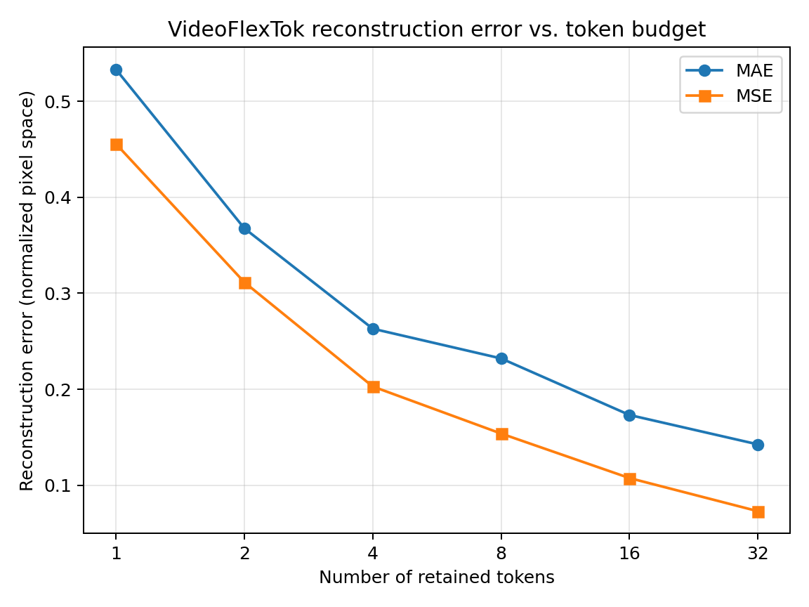

# VideoFlexTok: Reconstruction Quality vs. Token Budget

## Overview

This project is a small, independent inference experiment using the official
pretrained VideoFlexTok model. It investigates how the number of retained
tokens relates to pixel-level video reconstruction error.

**This is not a full reproduction of the paper.** The pretrained model was
used for inference only; it was not trained or fine-tuned.

## Research question

How does reconstruction error change as the token budget increases?

## Experimental setup

- **Model:** `EPFL-VILAB/videoflextok_d18_d18_k600`
- **Input:** 17 frames resized to 128 × 128
- **Hardware:** Google Colab Tesla T4
- **Decoder:** 40 timesteps, guidance scale 25, seed 42
- **Metrics:** Mean absolute error (MAE) and mean squared error (MSE)
- **Implementation:** Official VideoFlexTok repository and pretrained checkpoint

## Results: Porsche clip

| Token budget | MAE | MSE |
|---:|---:|---:|
| 1 | 0.533345 | 0.455757 |
| 2 | 0.367715 | 0.311558 |
| 4 | 0.263099 | 0.202908 |
| 8 | 0.232112 | 0.153848 |
| 16 | 0.173179 | 0.107460 |
| 32 | 0.142556 | 0.072954 |

From 1 to 32 tokens, MAE decreased by **73.3%** and MSE by **84.0%** for
this clip and setup.

## Comparison across two clips

| Clip | Token budget | MAE | MSE |
|---|---:|---:|---:|
| Porsche | 8 | 0.232112 | 0.153848 |
| Porsche | 32 | 0.142556 | 0.072954 |
| Second clip (`orig_clip`) | 8 | 0.305406 | 0.161627 |
| Second clip (`orig_clip`) | 32 | 0.148140 | 0.057570 |

## Interpretation

For both tested clips, the recorded pixel errors were lower at 32 tokens than
at 8 tokens. For the Porsche clip, error also decreased across the tested
budgets from 1 to 32 tokens.

These are preliminary observations from only two clips. Pixel-level errors do
not fully measure perceptual quality, semantic preservation, or temporal
consistency.

## Limitations

- Only two clips were tested.
- The second clip was evaluated only at 8 and 32 tokens.
- Porsche measurements at 1, 2, 4, and 8 tokens were recorded in an earlier
  runtime; the 16- and 32-token measurements were recorded after a runtime reset.
- No repeated-seed analysis, perceptual metric evaluation, downstream-task
  evaluation, or model training was performed.
- Results depend on preprocessing and decoder settings.
- The notebook analyzes saved outputs; it does not rerun inference from scratch.

## Project files

- [`VideoFlexTok_Token_Budget_Experiment.ipynb`](VideoFlexTok_Token_Budget_Experiment.ipynb) — experiment overview and analysis
- [`environment.json`](environment.json) — recorded runtime and package versions
- [`results/token_budget_results.csv`](results/token_budget_results.csv) — Porsche measurements
- [`results/second_clip_results.csv`](results/second_clip_results.csv) — selected measurements for both clips
- [`results/token_budget_error.png`](results/token_budget_error.png) — error plot
- [`results/original_vs_32_tokens.png`](results/original_vs_32_tokens.png) — visual comparison

## References and attribution

- [Official VideoFlexTok repository](https://github.com/apple/ml-videoflextok)
- [VideoFlexTok project page](https://videoflextok.epfl.ch/)
- [Pretrained checkpoint](https://huggingface.co/EPFL-VILAB/videoflextok_d18_d18_k600)

Consult the upstream repository's license and citation instructions before
redistributing upstream code or model assets.
