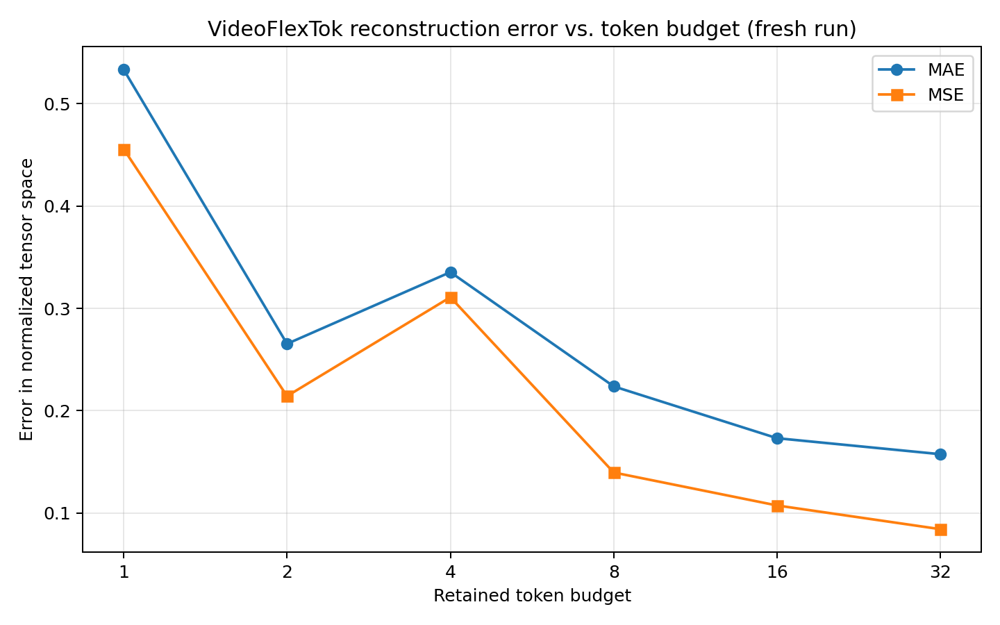

# VideoFlexTok: Reconstruction Quality vs. Token Budget

## Overview

This project is an independent inference experiment using the official pretrained VideoFlexTok model. It investigates how the token budget relates to pixel-level video reconstruction error.

**This is not a full reproduction of the VideoFlexTok paper.** The pretrained model was used for inference only; no model training or fine-tuning was performed.

## Research Question

How does reconstruction error change as the token budget increases?

## Experimental Setup

- **Model:** `EPFL-VILAB/videoflextok_d18_d18_k600`
- **Input:** 17 frames resized to 128 × 128
- **Hardware:** Google Colab Tesla T4 GPU
- **Decoder:** 40 timesteps, guidance scale 25
- **Seed:** 42 for the fresh run
- **Metrics:** Mean absolute error (MAE) and mean squared error (MSE)
- **Implementation:** Official VideoFlexTok repository and pretrained checkpoint

Lower MAE and MSE indicate lower pixel-level reconstruction error.

## Results: Fresh Porsche Clip Run

The following measurements were collected in the run recorded under `results/rerun/20261024-121933-6f728c62/`.

| Token budget | MAE | MSE |
|---:|---:|---:|
| 1 | 0.533345 | 0.455757 |
| 2 | 0.265420 | 0.214330 |
| 4 | 0.335460 | 0.310970 |
| 8 | 0.223820 | 0.139670 |
| 16 | 0.173180 | 0.107460 |
| 32 | 0.157560 | 0.084280 |

From 1 to 32 tokens, MAE decreased by approximately **70.5%**, and MSE decreased by approximately **81.5%** in this run.

The trend is not strictly monotonic: reconstruction error at 4 tokens was higher than at 2 tokens. This result is retained rather than excluded from the analysis.

## Historical Results: Porsche Clip

The repository also preserves measurements from earlier inference sessions.

| Token budget | MAE | MSE |
|---:|---:|---:|
| 1 | 0.533345 | 0.455757 |
| 2 | 0.367715 | 0.311558 |
| 4 | 0.263099 | 0.202908 |
| 8 | 0.232112 | 0.153848 |
| 16 | 0.173179 | 0.107460 |
| 32 | 0.142556 | 0.072954 |

In the historical measurements, MAE decreased by approximately 73.3% and MSE by approximately 84.0% from 1 to 32 tokens.

These values are preserved as historical results, not substituted for the fresh-run measurements.

## Comparison Across Two Clips

The second clip, `orig_clip`, was evaluated at only two token budgets.

| Clip | Token budget | MAE | MSE |
|---|---:|---:|---:|
| Porsche, historical | 8 | 0.232112 | 0.153848 |
| Porsche, historical | 32 | 0.142556 | 0.072954 |
| `orig_clip`, historical | 8 | 0.305406 | 0.161627 |
| `orig_clip`, historical | 32 | 0.148140 | 0.057570 |
| Porsche, fresh run | 8 | 0.223820 | 0.139670 |
| Porsche, fresh run | 32 | 0.157560 | 0.084280 |

For both clips, the historical measurements show lower pixel-level error at 32 tokens than at 8 tokens. The fresh Porsche run shows the same comparison.

However, differences between historical and fresh measurements mean the runs should not be treated as exact reproductions of one another.

## Interpretation

The experiments show a general tendency for reconstruction error to be lower at larger tested token budgets. This pattern appears in both the historical two-clip comparison and the fresh Porsche run.

The fresh run also demonstrates that error does not necessarily decrease at every successive token budget: the 4-token result is worse than the 2-token result.

These observations are preliminary. They do not establish a universal relationship between token budget and reconstruction quality across all videos or tasks.

Pixel-level MAE and MSE do not fully capture perceptual quality, semantic preservation, or temporal consistency.

## Reproducibility and Limitations

- Only two video clips were tested.
- The second clip was evaluated only at 8 and 32 tokens.
- Historical and fresh Porsche results differ at several token budgets.
- Although the fresh run records seed 42, matching a seed alone does not guarantee identical outputs across different software environments or inference implementations.
- No repeated-seed analysis, perceptual-metric evaluation, downstream-task evaluation, or model training was performed.
- Results depend on preprocessing, decoder settings, and software versions.
- The recorded environment metadata is available for the fresh run.
- The experiment does not constitute a full reproduction of the original paper.

Further work should investigate the run-to-run differences, repeat inference under controlled conditions, and evaluate additional clips before drawing stronger conclusions.

## Project Files

### Notebook and environment

- [`VideoFlexTok_Token_Budget_Experiment.ipynb`](VideoFlexTok_Token_Budget_Experiment.ipynb) — original experiment overview and analysis
- [`environment.json`](environment.json) — original recorded environment metadata

### Historical results

- [`results/token_budget_results.csv`](results/token_budget_results.csv) — historical Porsche measurements
- [`results/second_clip_results.csv`](results/second_clip_results.csv) — historical measurements for the second clip
- [`results/token_budget_error.png`](results/token_budget_error.png) — historical error plot
- [`results/original_vs_32_tokens.png`](results/original_vs_32_tokens.png) — historical visual comparison

### Fresh inference run

- [`environment.json`](results/rerun/20261024-121933-6f728c62/environment.json) — fresh-run environment metadata
- [`token_budget_results.csv`](results/rerun/20261024-121933-6f728c62/token_budget_results.csv) — fresh Porsche measurements
- [`token_budget_error.png`](results/rerun/20261024-121933-6f728c62/token_budget_error.png) — fresh-run error plot
- [`original_vs_32_tokens.png`](results/rerun/20261024-121933-6f728c62/original_vs_32_tokens.png) — fresh-run visual comparison

## References and Attribution

- [Official VideoFlexTok repository](https://github.com/apple/ml-videoflextok)
- [VideoFlexTok project page](https://videoflextok.epfl.ch/)
- [Pretrained checkpoint](https://huggingface.co/EPFL-VILAB/videoflextok_d18_d18_k600)

Consult the upstream repository's license and citation instructions before redistributing upstream code or model assets.
